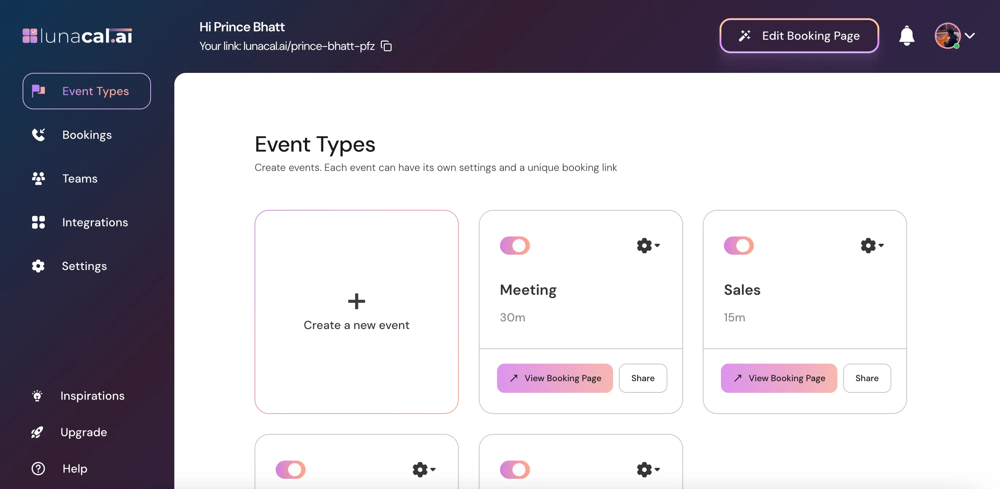
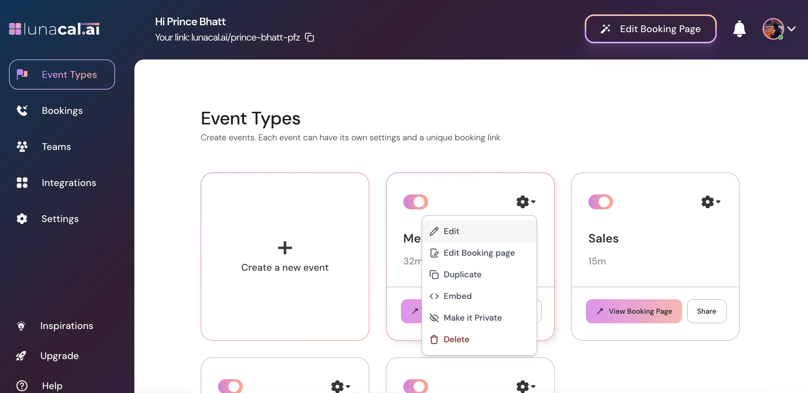
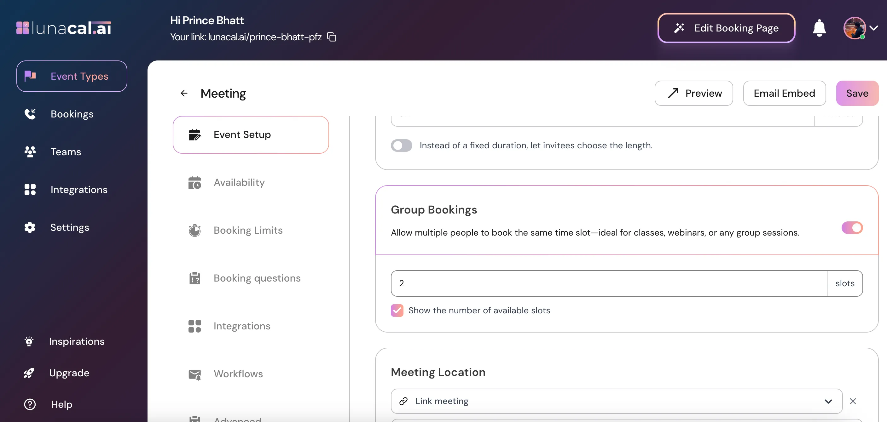
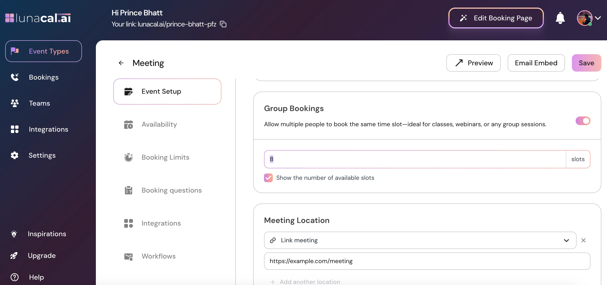

## What is group booking?

**Group booking** lets multiple participants book the same time slot, up to a capacity set by the organizer. It is useful for appointments where several people attend one session, such as classes, workshops, or group consultations.

In LunaCal’s appointment booking software, enable **Group Bookings** under **Event Setup** for the event you want to configure.

## How do group booking limits work?

- Set a maximum of **1–30 participants per time slot**.
- Each slot has its own capacity. A full slot is hidden from the booking page.
- When a cancellation frees a seat, availability updates automatically and a previously full slot becomes bookable again.

## How to set up group bookings in LunaCal

### Open Event Types

Go to [Event Types](https://app.lunacal.ai/event-types) in your dashboard.

<Frame>
  
</Frame>

### Select the event

Find the event you want to use for group bookings and click the settings icon on its event card.

<Frame>
  
</Frame>

### Edit the event

Choose **Edit** from the dropdown menu.

<Frame>
  
</Frame>

### Find Group Bookings

In **Event Setup**, scroll down to **Group Bookings**.

<Frame>
  
</Frame>

### Enable group bookings

Turn **Group Bookings** on to allow multiple people to book the same time slot.

<Frame>
  
</Frame>

### Set the participant limit

Enter the maximum number of participants allowed per slot. Choose a number from **1 to 30**.

**Example:** For a workshop with room for 10 people, set the limit to 10. Each workshop time slot then has its own 10-person capacity.

<Frame>
  
</Frame>

### Save your settings

Click **Save** to apply the changes.

<Frame>
  
</Frame>

## What happens as seats are booked or cancelled?

| Situation | What attendees see | How LunaCal handles capacity |
| --- | --- | --- |
| A slot has available seats | The time slot is available to book. Remaining seats are shown if that display is enabled. **Example:** “3 spots left”. | Each new booking reduces the seats available for that slot. |
| A slot reaches its capacity | The full time slot is hidden from the booking page. | Bookings cannot exceed the per-slot capacity. |
| Someone cancels and frees a seat | The available seat count updates. A previously hidden full slot becomes visible again. | The seat count increases by one and the slot reopens automatically, with availability updated in real time. |
| A per-booking seat limit is configured | Attendees can book only up to the maximum seats allowed per booking. | The per-booking limit applies alongside the slot’s overall capacity. |
| Several slots still have seats | Attendees can choose any available time slot. | Capacity is managed separately for each slot, not globally across the event. |

## Why use LunaCal for group session bookings?

LunaCal’s scheduling tool manages capacity separately for every session, so a full workshop does not close other time slots that still have seats.

Full slots disappear from the booking page, and cancellations automatically restore availability. You can also show remaining seats when that display is enabled, helping attendees see whether a session still has room.

## Frequently asked questions

### How do I let multiple people book the same time slot?

Turn on **Group Bookings** in the event’s **Event Setup** section in LunaCal, set the maximum participants per slot, and click **Save**. Multiple attendees can then book that slot until its capacity is reached.

### How many people can book a group session?

LunaCal lets you set a participant limit from **1 to 30 per time slot**. The limit applies to each slot independently, rather than to all bookings across the event.

### What happens when a group session is full?

LunaCal hides a fully booked time slot from the booking page and prevents bookings beyond its capacity. Other time slots with available seats remain bookable.

### Does a cancelled booking make the seat available again?

Yes. When a cancellation frees a seat in LunaCal, the available seat count increases and the slot reopens automatically. If it was hidden because it was full, it becomes visible again with updated availability.

### Can attendees see how many spots are left?

Yes, when the remaining-seat display is enabled, attendees can see how many seats are left in a group time slot. Once the slot is full, LunaCal hides it from the booking page.
