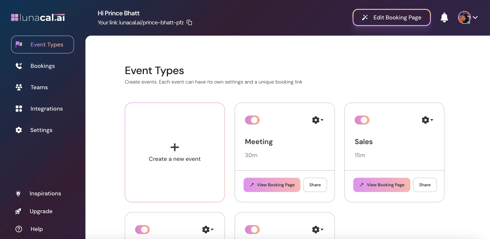
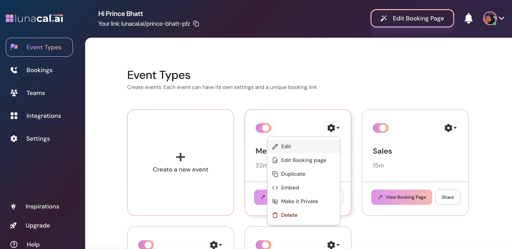

## What is package booking?

**Package booking** lets an attendee select multiple appointment time slots in one booking flow. A fixed package requires an exact number of sessions; a flexible package lets the attendee choose a number within a range you set.

LunaCal’s appointment booking software supports packages for individual events and team events, except **Collective Scheduling** events.

## Which package option should I use?

- **Fixed Slot:** Require a specific number of sessions for a course or structured program.
- **Flexible Range:** Let attendees choose how many sessions to book within your minimum and maximum.
- **Recurring bookings:** Let attendees fill package slots using a repeating schedule, where supported.

> Package Booking does not work with Collective Scheduling events. Recurring bookings also cannot be used when **Seats** are enabled on the event.

## How to set up a session package in LunaCal

### Open Event Types

Go to [Event Types](https://app.lunacal.ai/event-types) in your dashboard.

<Frame>
  
</Frame>

### Select the event

Select the event you want to configure, or click the settings icon on its event card.

<Frame>
  
</Frame>

### Edit the event

Choose **Edit** from the dropdown menu.

<Frame>
  
</Frame>

### Enable a multi-session package

In **Event Setup**, find **Create a Multi-Session Package** and turn it on. Enter a session count from **1 to 20**.

### Choose a fixed count or flexible range

| Setting | Fixed Slot | Flexible Range |
| --- | --- | --- |
| Session count | You set an exact number. | You set a minimum and maximum. |
| What attendees must select | Exactly the specified number of sessions. | Any number within the allowed range. |
| When booking can be completed | After all required slots are selected. | Once the selection falls within the range. |
| **Example:** Package size | 4 sessions. | 2–6 sessions. |
| **Example:** Attendee selection | The attendee must select exactly 4 sessions. | The attendee can select 2, 3, 4, 5, or 6 sessions. |
| Suitable uses | Fixed programs, paid bundles, and structured courses. | Coaching, mentoring, and flexible session packages. |
| Pricing considerations | Suits a set package price. | Suits an offering where pricing depends on session count. |
| Expectations to communicate | Every required session must be selected. | Attendees may choose fewer than the maximum; explain what each package includes. |

**Example:** With a flexible range of 2–6 sessions, an attendee can choose 6 sessions, as in the booking flow below.

## How do recurring bookings work within a package?

Recurring bookings generate session dates from a repeating pattern, so attendees do not have to choose every date individually. **Package Booking must be enabled first.** Recurring bookings are unavailable for Collective Scheduling events and events with Seats enabled.

### Enable recurring bookings

In the package settings area, turn on **Allow Recurring Bookings**. Select one or more patterns for attendees to choose from.

| Pattern | Schedule |
| --- | --- |
| Daily | Every day. |
| Weekly | The same day every week. |
| Biweekly | The same day every 2 weeks. |
| Every 3 weeks | The same day every 3 weeks. |
| Every 4 weeks | The same day every 4 weeks. |
| Monthly (same date) | The same date each month. **Example:** The 22nd. |
| Monthly (same weekday) | The same weekday each month. **Example:** The fourth Wednesday. |

Attendees can choose only from the patterns you enable.

### Add recurring sessions as an attendee

When an attendee selects a time slot while building a package, they can choose:

- **Add this slot to package** to add that date manually.
- **Make this slot recurring** to open the recurring sessions dialog.

In the dialog, the attendee selects an allowed pattern and the number of repetitions, up to the remaining slots in their package. They review the preview summary, then confirm to add all generated slots to the package at once.

**Example:** The preview can describe a weekly Wednesday appointment starting June 11 for four sessions.

Dates that are not available are marked **Unavailable**. The attendee must adjust those dates before completing the booking.

### Combine recurring and manually selected dates

| Approach | How dates are selected | When it helps |
| --- | --- | --- |
| Manual selection | The attendee chooses each available date individually. | Irregular schedules or varying availability; more individual selections are needed. |
| Recurring selection | The attendee chooses a pattern and dates are generated together. | Regular schedules, such as weekly coaching or monthly sessions; dates follow the selected pattern. |

Attendees can use both methods in the same package: choose some slots manually and fill the rest with a recurring pattern.

### Understand confirmations, calendars, and changes

- **Confirmation emails:** Only the first session in a recurring series triggers a confirmation email to you and the attendee. Subsequent sessions are booked without additional confirmation emails.
- **Calendar sync:** Google Calendar and Outlook receive a single recurring calendar event using the recurrence rule, rather than separate events for every session.
- **Removing a session:** Attendees can remove individual slots after adding a recurring series to their package. Removing a middle slot splits the series into two groups automatically.
- **Rescheduling:** Recurring slot selection is unavailable when rescheduling an existing booking. Attendees must adjust slots manually.

## Why use LunaCal for multi-session appointments?

LunaCal’s scheduling tool supports an exact session count for structured programs or a flexible range for clients who need different amounts of support.

Within supported packages, attendees can combine recurring and manually selected dates. That lets a regular schedule accommodate individual dates without requiring every session to be selected separately. Unavailable generated dates are flagged for correction before the booking can be completed.

## Frequently asked questions

### Can I require clients to book a set number of sessions?

Yes. Choose **Fixed Slot** in LunaCal’s Package Booking settings and set the required count, from 1 to 20. Attendees must select exactly that number of slots before completing the booking. Use **Flexible Range** if they should be able to choose within a minimum and maximum instead.

### Why can’t I enable recurring bookings?

Recurring bookings require **Package Booking** to be enabled in LunaCal. They are not available for Collective Scheduling events or events with **Seats** enabled. Recurring slot selection is also unavailable during rescheduling.

### Can I mix recurring appointments with dates I choose myself?

Yes. In one LunaCal package, attendees can add individual dates with **Add this slot to package** and use **Make this slot recurring** to fill other slots with an allowed repeating pattern.

### What happens if a recurring appointment date is unavailable?

LunaCal flags the generated slot with an **Unavailable** badge. The attendee must adjust unavailable dates before completing the package booking.

### Will clients receive an email for every recurring session?

No. Only the first session in a recurring series sends a confirmation email to the attendee and host. Later sessions in that series are booked without additional confirmation emails. Google Calendar and Outlook receive the series as one recurring calendar event.
