## What does LunaCal’s Zoom integration do?

**The Zoom integration** lets LunaCal automatically create Zoom meetings for bookings when **Zoom Video** is selected as the event’s meeting location.

Setup has two parts in LunaCal’s appointment booking software:

- **Connect Zoom** through **Integrations → Conferencing** for your personal account or a team event type.
- **Assign Zoom to each event** through **Event Setup → Meeting Location → Zoom Video**, then save.

Connecting the account does not automatically select Zoom as the location for every event.

## How to connect Zoom to LunaCal

### Open Integrations

Go to [Integrations](https://app.lunacal.ai/apps) in your dashboard.

<Frame>
  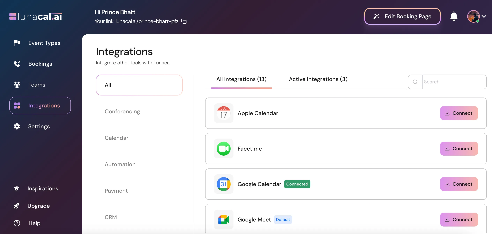
</Frame>

### Open Conferencing

Select [Conferencing](https://app.lunacal.ai/apps?tab=apps&category=conferencing).

<Frame>
  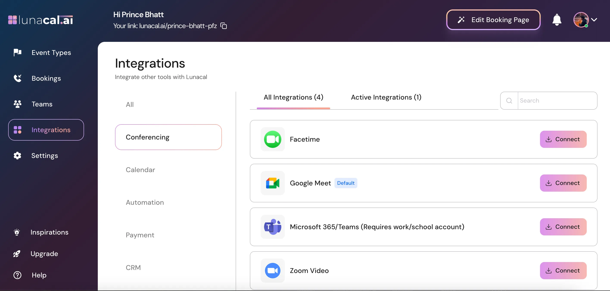
</Frame>

### Choose where to install Zoom Video

Select **Zoom Video**, then choose a team event type or your personal account.

**Example:** Choose a team event type such as “Sales North America” when connecting Zoom for that team’s events.

**Example:** Choose your personal account when connecting Zoom for your own appointments.

<Frame>
  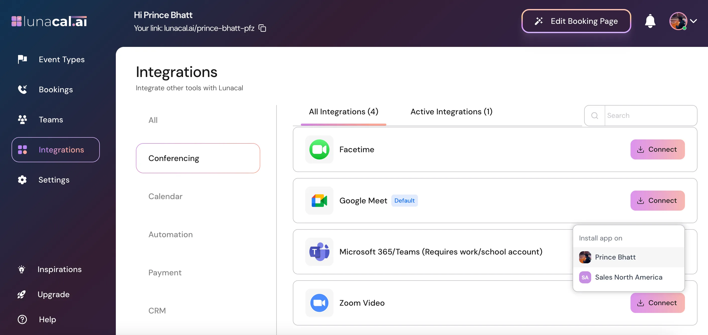
</Frame>

### Sign in to Zoom

Enter your Zoom credentials to connect the account you want to use.

<Frame>
  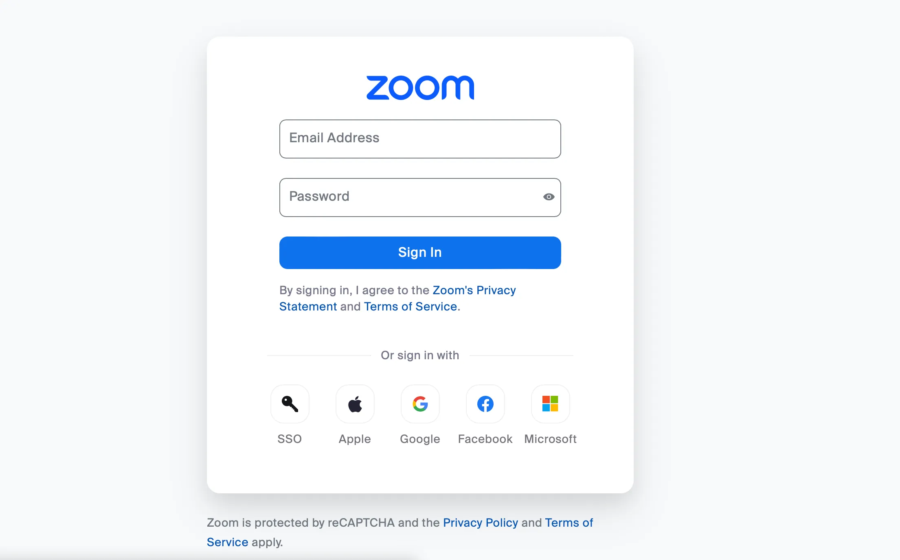
</Frame>

### Authorize the connection

Select the **View user** option when connecting Zoom. This permission allows LunaCal to access your Zoom profile and automatically create Zoom meetings for your bookings.

1. Click **I understood** to proceed.
2. On the Zoom authorization page, choose **View user** when prompted.
3. Click **Authorize** to complete the connection.

<Frame>
  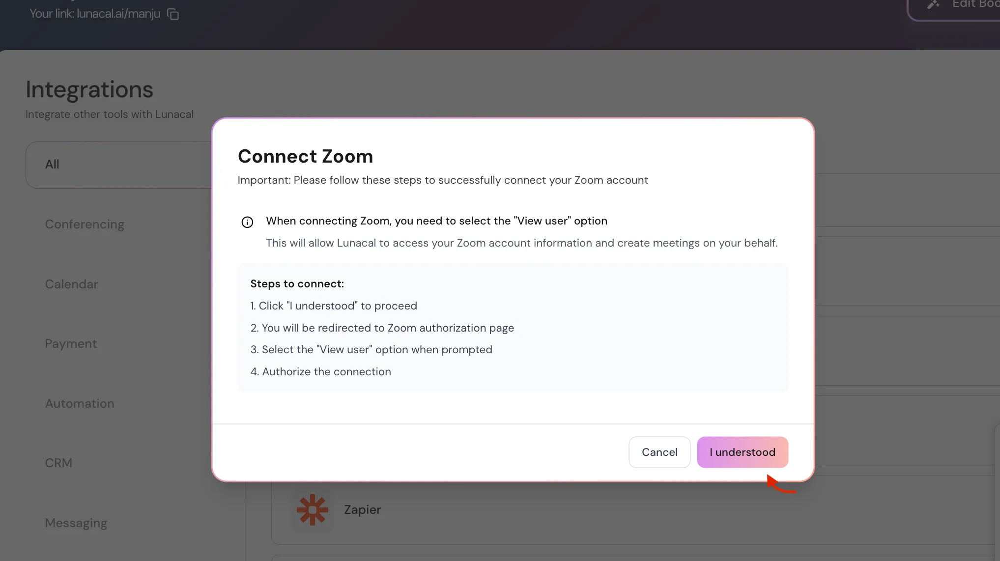
</Frame>

<Frame>
  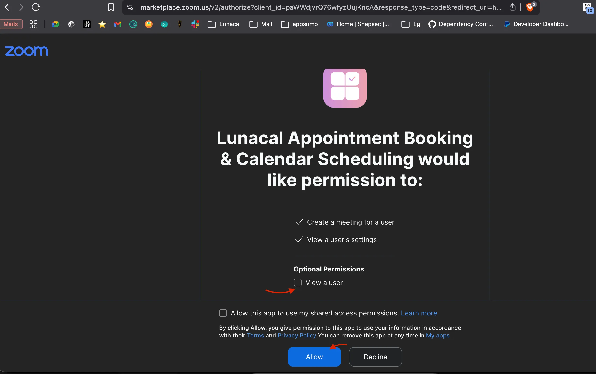
</Frame>

After connecting, Zoom links to your account and shows a **Connected** status. You must still select **Zoom Video** in the **Meeting Location** field for each event that should use it.

<Frame>
  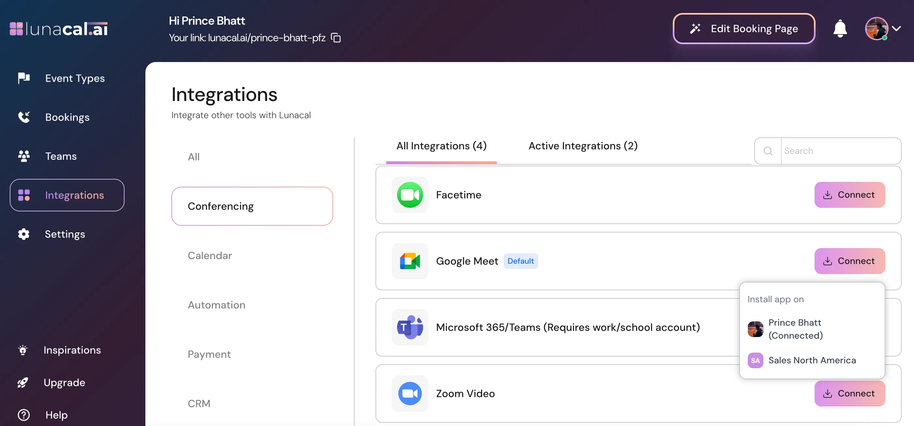
</Frame>

## How to set Zoom as an event’s meeting location

### Open Event Types

Go to **Event Types** in your dashboard.

<Frame>
  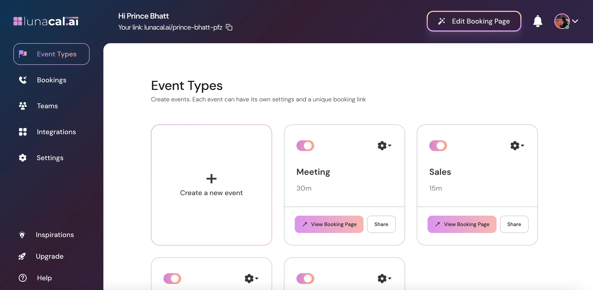
</Frame>

### Select the event

Find the event that should use Zoom and click the settings icon on its event card.

<Frame>
  
</Frame>

### Edit the event

Choose **Edit** from the dropdown menu.

<Frame>
  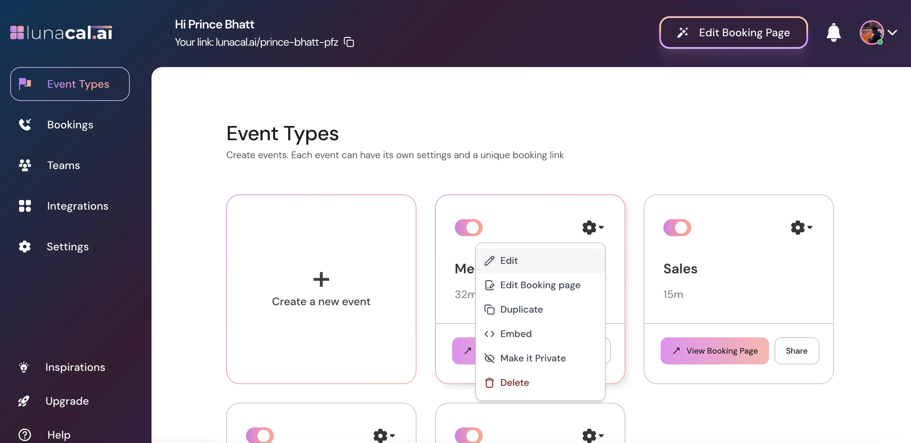
</Frame>

### Set the meeting location

In **Event Setup**, scroll down to **Meeting Location**.

<Frame>
  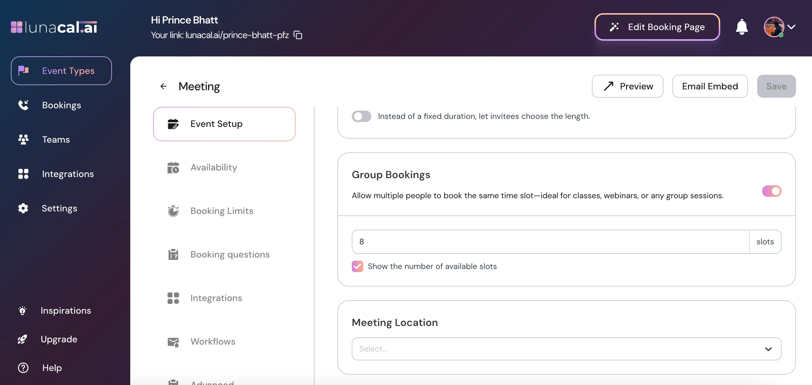
</Frame>

Select **Zoom Video** from the options.

<Frame>
  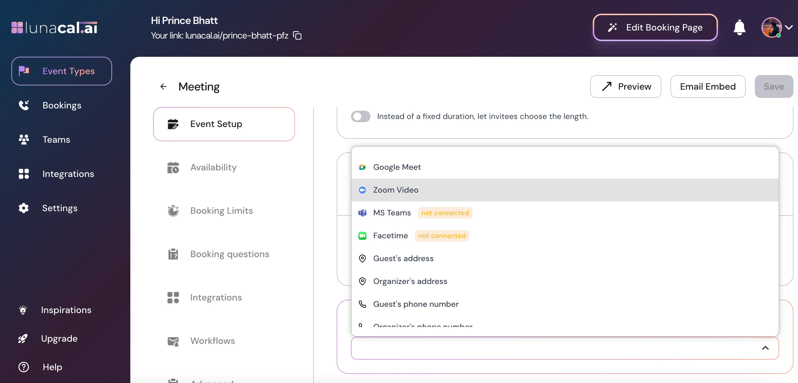
</Frame>

### Save your changes

Click **Save** to apply the meeting location.

<Frame>
  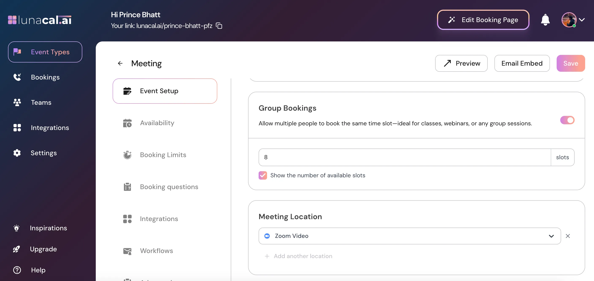
</Frame>

## Why use LunaCal to schedule Zoom appointments?

LunaCal’s scheduling tool connects appointment booking with Zoom meeting creation, so bookings for events configured with **Zoom Video** can create their Zoom meetings automatically.

You choose whether to install the integration for your personal account or a team event type, then select which events use Zoom. This gives you control over the connection’s scope and each event’s meeting location.

## Frequently asked questions

### How do I automatically create Zoom meetings when someone books?

Connect Zoom through LunaCal’s **Integrations → Conferencing** settings, then select **Zoom Video** as the event’s **Meeting Location** and click **Save**. Both the connection and the event location must be configured.

### Why isn’t Zoom being added to my appointments?

Check that Zoom shows a **Connected** status in LunaCal and that the relevant event has **Zoom Video** selected under **Meeting Location**. Save the event after selecting it. Connecting Zoom alone does not assign it to every event.

### Can I connect Zoom for a team?

Yes. When installing **Zoom Video** in LunaCal, you can choose a team event type or your personal account. Select the scope you need, then configure **Zoom Video** as the meeting location for the events that should use it.

### Does connecting Zoom change all my event locations?

No. In LunaCal, you must manually select **Zoom Video** in each event’s **Meeting Location** field and save the change. The account connection and event location are separate setup steps.

### Which Zoom permission do I need to select?

Choose **View user** when prompted during the LunaCal Zoom connection flow, then click **Authorize**. This is the permission option specified in the setup instructions for accessing your Zoom profile and creating meetings for bookings.
